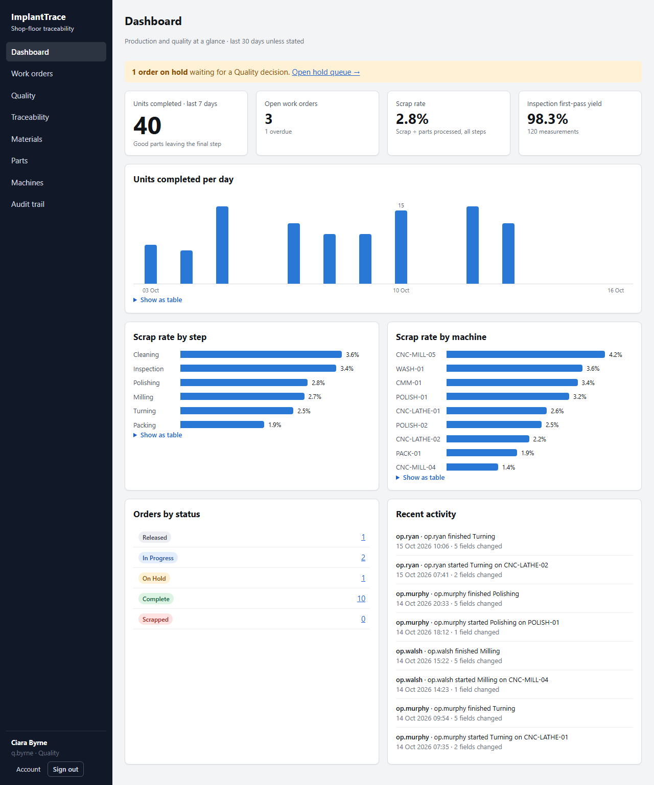
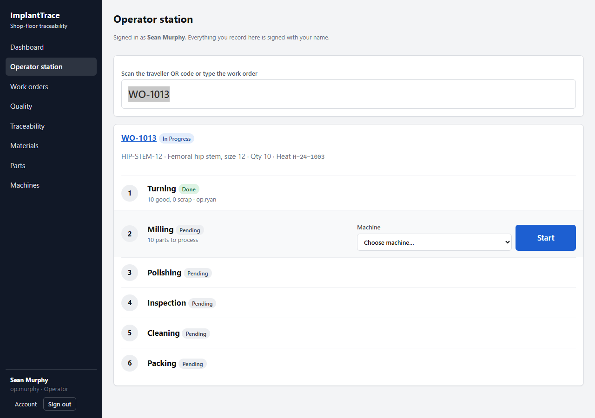
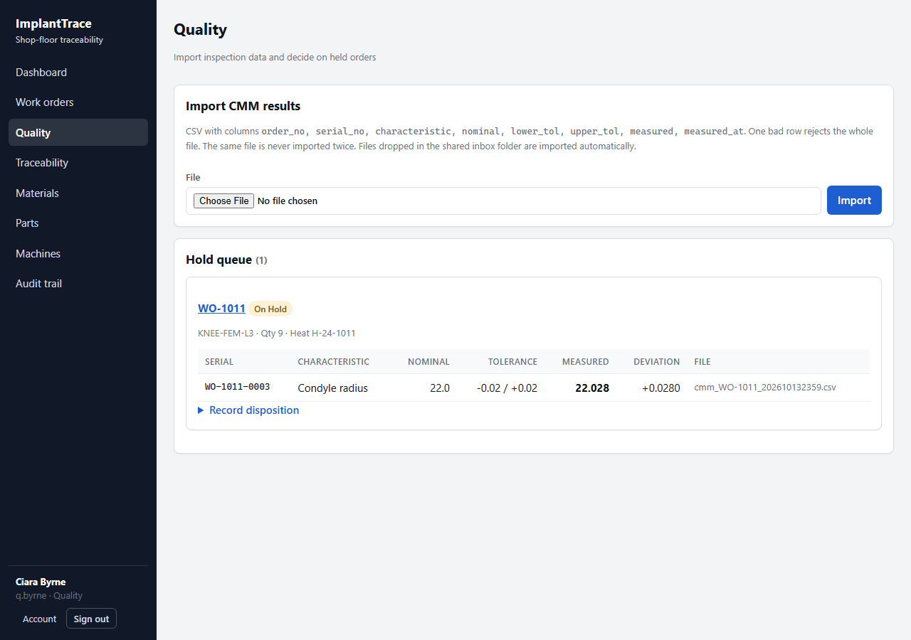
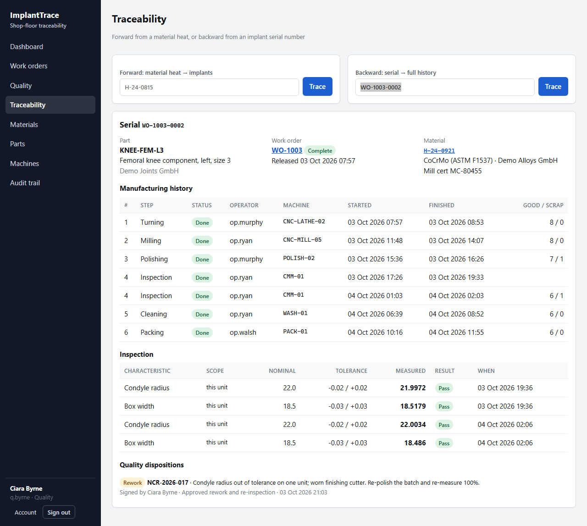
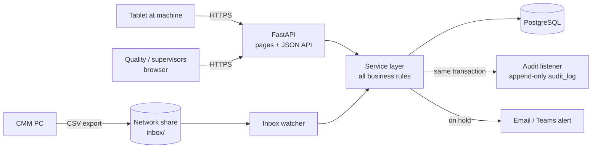

# ImplantTrace

**Shop-floor traceability for a precision machining plant that makes orthopaedic implants.**

Paper job sheets ("travellers") get lost, filled in late and are slow to search. When a
customer or auditor asks *"which implants were made from this bar of titanium?"*, someone
spends a day in filing cabinets. ImplantTrace replaces the paper traveller with a screen at
each machine, imports inspection results straight from the CMM, stops held work automatically,
and answers traceability questions in one search, with a tamper-evident audit trail and
electronic signatures.

> Portfolio project on synthetic data. Built to show how I would deliver a shop-floor
> application for a regulated manufacturer: requirements, rules, tests, deployment and support.



## What it does

| Who | What they get |
|---|---|
| **Operators** | Operator station: scan the traveller QR code, choose the machine, press **Start** / **Finish** with good and scrap counts. Steps must run in route order; quantities must reconcile; held orders are blocked. Every entry is signed with their own login. |
| **Supervisors** | Release work orders (serial numbers allocated automatically), receive material heats with mill certificates, manage parts, routes and machines, print travellers with QR codes. |
| **Quality** | CMM CSV exports are imported by upload or from a watched network folder. Any out-of-tolerance value fails Inspection, puts the order **ON HOLD**, and alerts Quality by email/Teams. Quality records a **disposition** (rework / use-as-is / scrap) with an NCR number and an **electronic signature** (password re-entry). |
| **Customers / auditors** | **Forward trace**: material heat → every order and serial made from it. **Backward trace**: serial → material cert, every operator, machine and timestamp, every measurement, every Quality decision. |
| **Admins** | User accounts with roles, password policy, lockout, deactivation (never deletion). |
| **Everyone** | Dashboard: output per day, scrap rate by step and machine, first-pass yield, hold queue, recent activity. |

## Screens

| Operator station | Quality hold queue | Backward trace |
|---|---|---|
|  |  |  |

## Quick start (local, no Docker)

```bash
python -m venv .venv
.venv\Scripts\activate                 # Linux/macOS: source .venv/bin/activate
pip install -r requirements-dev.txt
python -m scripts.seed                 # migrates the DB and loads two weeks of demo history
uvicorn app.main:app --reload
```

Open <http://localhost:8000> and sign in. Demo users all use the password **`Implant2026`**:

| User | Role | Try |
|---|---|---|
| `op.murphy` | Operator | Operator station → `WO-1013`, start Milling |
| `s.oconnor` | Supervisor | Work orders → release a new order, print its traveller |
| `q.byrne` | Quality | Quality → import `sample_data/cmm_WO-1013_out_of_tolerance.csv`, then sign a disposition for `WO-1011` |
| `admin` | Admin | Users, audit trail, everything |

API docs (OpenAPI): <http://localhost:8000/api/v1/docs>

## Run with Docker (PostgreSQL)

```bash
cp .env.example .env        # set SECRET_KEY and POSTGRES_PASSWORD
docker compose up --build -d
docker compose exec api ./docker-entrypoint.sh seed      # optional demo data
# or create the first real admin:
docker compose exec api ./docker-entrypoint.sh create-user admin "Plant Administrator" ADMIN
```

Three services: `db` (PostgreSQL 16), `api` (runs migrations, then the web app), `watcher`
(imports CSVs dropped in `./inbox`). Production setup: [docs/deployment.md](docs/deployment.md).

## Architecture



- **One rule book.** Every change, from the browser, the API, the folder watcher or the seed
  script, goes through the same service functions, so the same rules and permissions apply.
- **Server-rendered UI, no build step.** Pages are Jinja templates; a 200-line `app.js` sends
  form submissions to the JSON API. Works on old shop-floor PCs and tablets.
- **Audit at the ORM layer.** A SQLAlchemy flush listener records every insert/update/delete with
  user, old → new value and reason, in the same transaction. Changes without a reason are refused.
  The audit table is append-only in the app *and* by PostgreSQL trigger.

More: [docs/architecture.md](docs/architecture.md).

## Quality of engineering

| | |
|---|---|
| **Tests** | 77 automated tests: production rules, import validation, dispositions, traceability, audit, auth/CSRF/lockout, every page renders, and a check that migrations match the models. CI runs them on SQLite **and** PostgreSQL. |
| **Security** | Argon2 password hashing, httpOnly SameSite cookies + CSRF double-submit token, role checks on every endpoint, account lockout and login throttling, sessions invalidated on password change/deactivation, strict Content-Security-Policy, no secrets in the audit trail, production start-up refuses unsafe settings. |
| **Operations** | Alembic migrations, `/health` and `/ready` probes, JSON logs with request IDs, non-root Docker image with health check, graceful watcher shutdown, alerts that never block production. |
| **Data integrity** | Idempotent imports (SHA-256), all-or-nothing file validation, Decimal tolerance checks, quantities reconcile step to step, routes copied onto each order so history never changes. |

```bash
pytest -q                 # tests
ruff check . && ruff format --check .
```

## Regulated environment

Software used to make medical devices is part of the quality system (ISO 13485, FDA 21 CFR 820
and Part 11). What is built in, and what validation would add: [docs/validation.md](docs/validation.md).

## Project layout

```
app/
  models.py          data model (traceability chain)
  audit.py           automatic audit trail
  security.py deps.py   passwords, sessions, CSRF, role checks
  services/          business rules: production, quality, import, trace, dashboard, users
  routers/           JSON API (/api/v1) and server-rendered pages
  templates/ static/ UI
migrations/          Alembic (incl. PostgreSQL append-only trigger)
scripts/             seed, create_user, watch_inbox
tests/               pytest suite
docs/                architecture, deployment, user guide, validation
```

## Roadmap

- [ ] Single sign-on (Microsoft Entra ID) and badge login at the station
- [ ] Unit-level status (scrap individual serials, not just counts)
- [ ] Customer certificate of conformance PDF per order
- [ ] Machine status from MTConnect / OPC UA agents
- [ ] Plant time zone handling for CMM timestamps (currently treated as UTC)
- [ ] ERP integration: pull released orders, push completions
