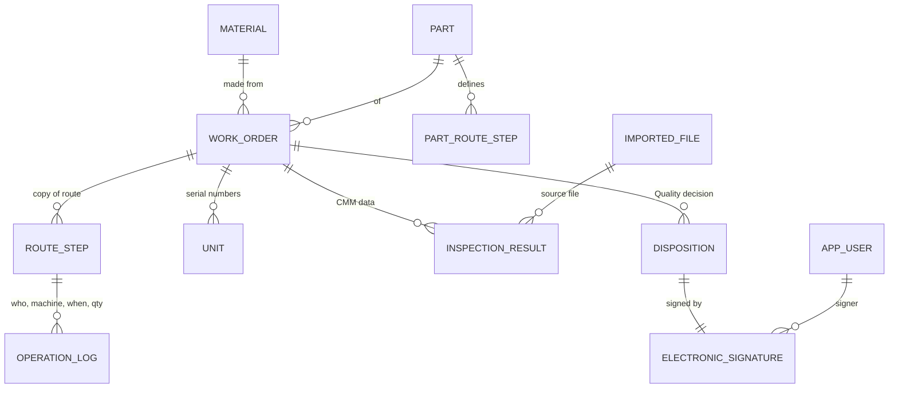
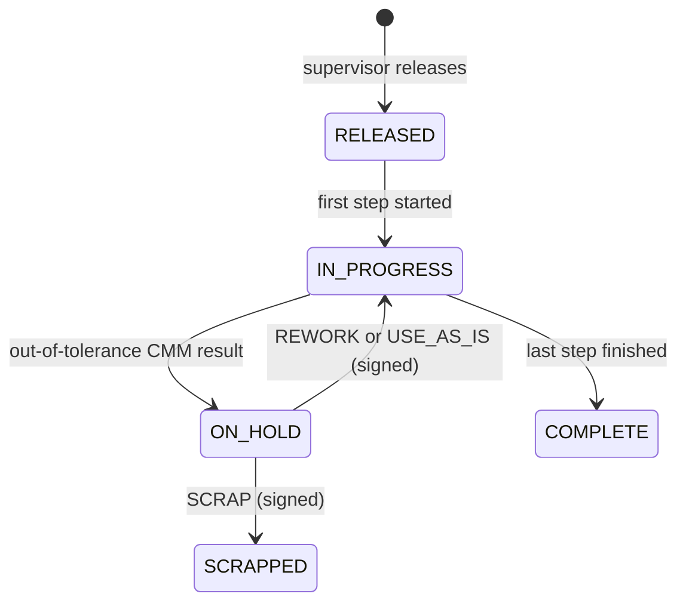

# Architecture

## Components

| Component | What it is | Why |
|---|---|---|
| Web app (`app/main.py`) | FastAPI serving server-rendered pages and a JSON API under `/api/v1` | One deployable; pages work on any browser without a front-end build |
| Service layer (`app/services/`) | Plain functions holding every business rule | Same rules for UI, API, folder watcher and scripts; easy to unit test |
| Audit listener (`app/audit.py`) | SQLAlchemy `before_flush` / `after_flush` hooks | Nobody can forget to audit a new feature |
| Inbox watcher (`scripts/watch_inbox.py`) | Separate process polling a folder | CMM PCs already export CSV to a share; no change on their side |
| PostgreSQL | System of record | Transactions, constraints, append-only trigger |

## Data model

`audit_log` sits beside all of these and records every change to every row.

## Order lifecycle

## Key rules (all in `app/services/`)

| Rule | Where |
|---|---|
| Steps run strictly in route order | `production.start_step` |
| Machine must exist and be in service | `production.start_step` |
| Good + scrap must equal the parts that entered the step | `production.finish_step`, `qty_into_step` |
| Only the operator who started a step, or a supervisor, can finish it | `production.finish_step` |
| Inspection can only finish with imported results and no unresolved failures | `production.finish_step`, `open_inspection_failures` |
| A route is locked once a part has orders; process changes need a new part revision | `masterdata.replace_route` |
| Import files: all-or-nothing, idempotent by SHA-256, serials must belong to the order | `inspection_import.import_inspection_file` |
| Dispositions need the Quality role, an NCR number, a justification and a password re-entry | `quality.dispose`, `quality.sign` |
| Every update/delete needs a reason; the audit log cannot be changed | `audit.py`, `models.AuditLog`, migration trigger |

## Request flow (browser)

1. Page request → `deps.page_user` reads the session cookie → service functions read data →
   Jinja renders HTML.
2. User submits a form → `app.js` sends JSON to `/api/v1/...` with the CSRF token header →
   `deps.current_user` checks session, CSRF and role → service function applies the rules →
   router commits → page reloads with a confirmation message.

## Security model

- Sessions: signed JWT (HS256) in an httpOnly, SameSite=Strict cookie; `sv` claim must match the
  user's `session_version`, which is bumped on password change, deactivation and role change.
- CSRF: double-submit token (`it_csrf` cookie must equal `X-CSRF-Token` header) on every
  cookie-authenticated write. API clients use `Authorization: Bearer`, which is not sent
  automatically by browsers and needs no CSRF token.
- Roles: OPERATOR, SUPERVISOR, QUALITY, ADMIN (ADMIN passes every check). Checked per endpoint
  and per page.
- Passwords: Argon2id, policy (10+ chars, mixed case, digit), lockout after 5 failures for 15 min,
  per-IP login throttle, constant-time response for unknown users.
- Headers: strict CSP (no inline script/style), X-Frame-Options DENY, nosniff, HSTS when secure.
